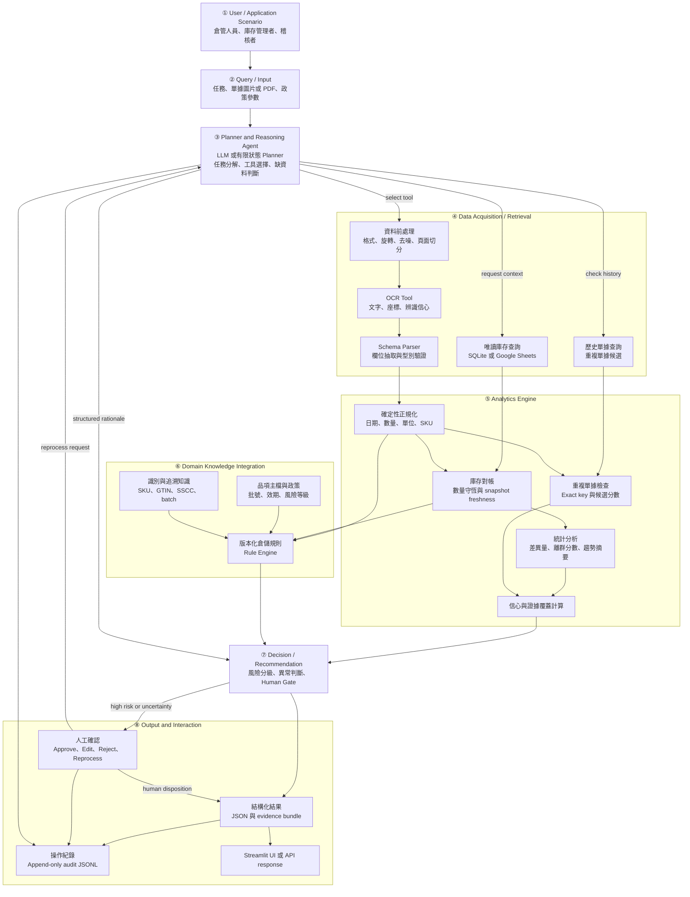
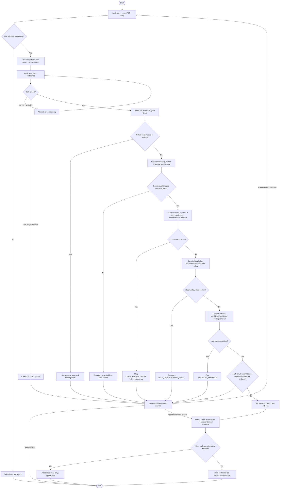

# 智慧倉儲單據辨識與庫存異常決策代理人

## Smart Warehouse AI Agent: Document Understanding and Inventory Anomaly Decision Agent

### Final Project Proposal

> **文件狀態（2026-10-25）**：本頁為可直接閱讀的完整期末專題提案。研究設計與可執行 MVP 已建立；正式資料蒐集、三組 baseline 實驗與統計推論尚未執行，因此所有成效均標示為 **Expected Outcomes / Not Run**，不宣稱不存在的成果。

## Table of Contents

- [1. Abstract 摘要](#abstract)
- [2. Introduction 緒論](#introduction)
- [3. Related Work 相關研究](#related-work)
- [4. Deep Research 深度研究](#deep-research)
- [5. Proposed Scheme / Proposed Design](#proposed-scheme)
- [6. Experiments / Evaluation Plan](#experiments)
- [7. References](#references)
- [8. Project Files / Attachments](#attachments)

---

<a id="abstract"></a>
# 1. Abstract 摘要

### A. Attention Getter / Motivation

倉儲數位化並不等於資料可靠。2025 年 IoT 倉儲系統性回顧指出，既有研究仍偏重理論框架與演算法，實際場域應用相對不足 [6]；2026 年智慧倉儲框架研究亦將 interoperability、cybersecurity、硬體資源與 human-centricity 列為持續挑戰 [9]。同時，2025 年文件 AI 研究已由單純 OCR 發展至能以工具處理表格、專業知識與格式驗證的 agentic workflow [1], [2]。這些證據共同顯示：真正的問題不只是「能否讀出文字」，而是能否將不確定的單據內容連結至正確庫存狀態、專業規則、可追溯證據與負責任的人工決策。

### B. But / Challenge

傳統 OCR 輸出文字與信心分數，卻不理解同一單據中的文件編號、倉別、SKU、數量、單位與棧板型式之業務關係；固定規則能檢查已知格式，但面對欄位缺漏、版型變化、模糊重複、庫存快照過期或資料來源衝突時，通常只能失敗或誤判。另一方面，多數智慧倉儲研究以已結構化資料為輸入，未處理 OCR 錯誤如何傳遞至後續庫存決策。若讓 LLM 直接產生處置，又會引入不可追溯陳述、權限越界及將低信心推測誤作事實的風險。

### C. Cure / Proposed Solution

本研究提出 **Smart Warehouse AI Agent**：一個 evidence-first、recommendation-only、human-gated 的 Domain AI Agent。它先理解收貨、出貨、盤點或重複檢查任務，再於允許清單內選擇 OCR、欄位解析、歷史單據、庫存查詢、分析與規則工具；最後輸出異常類型、風險等級、建議處置、信心、來源證據與 reason codes。系統不直接寫入正式 WMS；所有正式寫入前均須人工確認。

### D. Development / Method

系統以 Python 3.11、Streamlit、SQLite、Pandas 與可替換 OCR／LLM adapter 建構。確定性模組負責檔案驗證、schema、日期／數量／單位正規化、SQL、exact duplicate、數量守恆與必要欄位；統計模組負責信心彙整、差異量與離群摘要；版本化 Domain Knowledge 負責 SKU、倉別、批號／效期、庫存及風險規則；有限狀態 Planner 或受 schema 約束的 LLM 僅負責任務分解、允許工具選擇、缺資料補查、停止或升級。每項結論必須連結 OCR span、資料庫列或規則版本。

### E. Experiments / Evaluation

預定以 300–500 張匿名或合成中英倉儲單據建立主要資料集，每張配對不可變 inventory snapshot、master data、歷史單據與決策 ground truth；以 `vendor_id + template_id` 群組切分 60/20/20，避免同版型洩漏。三組 baseline 為 B0 人工輸入與人工核對、B1 OCR + Fixed Rules、B2 OCR + Domain AI Agent，三者使用相同 test cases 與庫存狀態。指標包含字元準確率、重要欄位 Exact Match、異常 Precision／Recall／F1、重複單據準確率、處理時間、人工介入率、工具選擇及任務完成率。

### F. Findings / Expected Outcomes

實驗目前為 **Not Run**。預期本研究可形成：（1）可重現的 document-to-decision 評估協定；（2）能區分 OCR、規則、統計、Agent 與人工權限的輕量架構；（3）逐項有證據且可回放的異常建議；（4）關於 Agent 相較固定流程是否改善任務完成、安全升級與人工負擔的實證結果。這些均為待驗證貢獻，而非既成效能聲明。

---

<a id="introduction"></a>
# 2. Introduction 緒論

## 2.1 A. Attention Getter

倉庫現場的收貨單、出貨單、盤點單與物流標籤常同時存在影像、PDF、試算表與資料庫。GS1 物流標籤規範以 SSCC、GTIN、count、batch/lot 及日期等 Application Identifiers 支援物流單元識別與追溯 [10]，說明正確識別與資料關聯是跨組織物流的基礎。然而，一個字元或單位辨識錯誤可能使同一實體被指向不同 SKU、批號或數量；這類錯誤若只追求 OCR 平均準確率，可能在真正的庫存決策點才被發現。

## 2.2 B. Background

Document AI 已由文字偵測與辨識，進展至 key information extraction、document VQA 與 agentic retrieval。SROIE [4] 建立收據 OCR/KIE benchmark；DocVQA [5] 將文件理解轉化為視覺問答；2025 年 DocAgent [1] 與 AID-Agent [2] 則加入動態查詢、reviewer 或 domain tools。倉儲研究同時涵蓋 IoT、inventory anomaly、AI picking、Digital Twin 與 KPI [6]–[9], [13]。本研究位於兩條研究線的交會：原始單據不是最終答案，而是觸發資料取得、專業核對與安全決策的證據來源。

## 2.3 C. Problem

本專題聚焦四項可測量研究問題：

- **RQ1 — Document understanding：** 在未見版型與影像劣化下，系統能否可靠抽取文件編號、日期、倉別、棧板型式、SKU、數量及單位？以 CER、欄位 EM、Document EM 衡量。
- **RQ2 — Anomaly decision：** 結合單據、庫存快照、歷史紀錄與版本化規則後，能否偵測 duplicate、缺欄、未知 SKU、數量／單位錯誤、庫存不足及倉別不一致？以 per-class 與 macro Precision／Recall／F1 衡量。
- **RQ3 — Agent value：** 相較 B0 人工與 B1 固定流程，B2 是否改善任務完成、工具選擇、處理時間或人工負擔，且不提高 false auto-accept？
- **RQ4 — Trustworthiness：** 系統能否使重要主張皆有 evidence ID、遇到低信心／衝突／過期資料時適當升級，並由 audit trail 重播？

研究目標為建立可執行的輕量 Agent、可重現資料與評估協定、三 baseline 公平比較，以及可由教師或倉管人員追查的 append-only audit trail。

## 2.4 D. Existing Limitations

現有方法主要有五項限制：（1）OCR accuracy 不等於業務欄位正確；（2）固定 pipeline 無法依中間結果改變工具或安全停止；（3）結構化倉儲模型通常忽略文件輸入的不確定性；（4）LLM 自由回答可能混淆事實、推測與政策；（5）公開 benchmark 缺少中英倉儲單據、配對庫存、規則命中及人工決策標註。此外，部分 2025–2026 研究只能取得摘要，不能據此推論完整方法或泛化性。

## 2.5 E. Innovation

本研究的創新不在於把一般函式改名為 Agent，而是建立具有選擇能力與責任邊界的 bounded planner。Agent 可依任務與 state 選擇歷史、庫存或分析工具，對缺資料重新規劃一次，並在 stop conditions 下升級；OCR、SQL、算術、硬規則及最終安全 gate 仍由可測試的確定性元件執行。系統以 **facts → conflicts/unknowns → rule hits → evidence-linked recommendation → human disposition** 表達決策，並刻意不保存或要求 hidden chain-of-thought。

## 2.6 F. Contributions

- **Research framing：** 將倉儲單據辨識定義為跨文件、庫存、規則與人工責任的 Domain AI Agent 問題。
- **System design：** 提出 evidence-first、recommendation-only、human-gated、local-first 架構。
- **Evaluation protocol：** 規劃共同測試資料、held-out template、影像劣化、ablation 與 decision-safety metrics。
- **Reproducible artifact：** 已建立 Python／SQLite MVP 與測試；後續預計補齊資料卡、完整實驗輸出、版本化 prompt／rules。敏感或未授權資料不公開。

---

<a id="related-work"></a>
# 3. Related Work 相關研究

## 3.1 Review Scope and Evidence Policy

核心研究共 10 篇：AI Technology 5 篇 [1]–[5]，Warehouse Domain Know-how 5 篇 [6]–[9], [13]，比例各半；GS1 [10]、產業調查 [11] 與 NIST [12] 作補充標準／治理證據。優先納入 2025–2026 正式出版研究，較早 SROIE、DocVQA 僅作基礎 benchmark。[7] 截至檢索日只核對出版者摘要與 metadata，作者名單、切分及完整實驗細節均標示 **待查證**，不假稱已讀全文。

## 3.2 AI Technology

SROIE 將文字定位、OCR 與 KIE 分開量測，但文件是收據且無庫存或決策標註 [4]；DocVQA 測試文字、影像與版面理解，答案多為文件片段，沒有外部庫存狀態 [5]。Principe et al. 比較 human、rules 與 LLM extraction，支持本研究不預設 LLM 必然優於規則 [3]。AID-Agent 以 OCR、LLM agent、domain/table tools 與 validator 處理 44 份工業 PDF [2]；DocAgent 則以結構綱要、動態頁面查詢及 reviewer agent 處理長文件 QA [1]。兩者支持工具化與覆核，但尚未回答倉儲 inventory mismatch、寫入責任與 evidence coverage。

## 3.3 Warehouse Domain Know-how

2025 IoT 倉儲回顧指出實務應用不足 [6]；2026 智慧倉儲框架將 CPS、Digital Twin、cobots、DRL、SKU flow 與 KPI 納入同一架構 [9]；2026 AI-enhanced Digital Twin review 涵蓋 inventory、storage assignment、AGV 與 anomaly detection [13]。一篇 2025 IEEE inventory anomaly 論文摘要報告以 12,358 SKU 資料得到 F1 87.3%，但其作者、split 與異常定義尚待全文查證，故不作直接 baseline [7]。Rad et al. 以訂單資料、模擬與利害關係人訪談研究 AI batch picking，提醒準確度之外尚有導入與組織問題 [8]。GS1 規範則支持 SKU／GTIN／SSCC／batch 等追溯欄位，但實際必填欄位仍須依品項主檔與組織政策決定 [10]。

## 3.4 Article Summary Table

| Ref. | Year | Problem | AI Method | Domain Knowledge | Dataset | Findings | Limitation |
|---|---:|---|---|---|---|---|---|
| [1] AI | 2025 | 長篇多模態文件難以可靠問答 | Tree outline、multi-agent、interactive retrieval、reviewer | 文件結構與跨來源核對 | 兩個 long-context document benchmarks | 作者報告優於其競爭 baselines | 非倉儲交易；無 inventory rules 或 human approval |
| [2] AI | 2025 | 複雜表格、跨頁與專業實體使一般 OCR/LLM 失敗 | LLM agent + OCR + customizable tools + validator | 工業技術文件與格式知識 | 44 份人工標註工業 PDF | Domain/table tools 支援資訊整合 | 小型單一案例；未處理庫存與安全決策 |
| [3] AI | 2025 | Domain IE 的準確、擴展與成本權衡 | LLM、rule-based、human comparison | 不動產拍賣文件 | Real-estate case study | 顯示 performance、maintainability、cost trade-off | 非倉儲；只有抽取，沒有外部工具決策 |
| [4] AI | 2019 | 缺少標準掃描收據 OCR/KIE benchmark | OCR、text localization、KIE competition | 公司、日期、地址、總額 | 1,000 張 scanned receipts | 建立三任務與評估程序 | 無 SKU、庫存或決策標註 |
| [5] AI | 2021 | OCR/KIE 不等於整體文件理解 | Document VQA baselines | 文件版面與問題語意 | 12,000+ images、50,000 questions | 結構相關問題仍具挑戰 | 無倉儲外部狀態與風險動作 |
| [6] Warehouse | 2025 | IoT 倉儲研究分散 | 系統性回顧與分類分析 | Warehouse、inventory、IoT | 2017–2023 納入文獻 | 研究偏理論，實際應用較少 | 回顧而非部署；未聚焦文件 AI |
| [7] Warehouse | 2025 | 多類 inventory anomaly 難用單一模型識別 | Local anomaly factor + attention RNN + Bayesian averaging | Inventory temporal／關聯特性 | 摘要稱 12,358 SKUs | 摘要報告 F1 87.3% | **僅摘要／metadata；作者、split、定義待查證**；輸入非影像 |
| [8] Warehouse | 2025 | AI batch picking 效益與採用障礙 | AI optimization、simulation、訪談 | Picking、ERP、員工作業 | Orders、simulation、stakeholder interviews | 作者報告距離／時間改善及導入挑戰 | 任務非單據辨識；單一實務脈絡 |
| [9] Warehouse | 2026 | 技術、流程與 KPI 缺乏整合 | SLR + conceptual framework | Inbound/storage/outbound、KPI | 2015–2025 文獻 | 整合 CPS、DT、cobots、DRL、SKU flows | 概念框架；無 document-to-decision 實驗 |
| [13] Warehouse | 2026 | AI、DT、IoT 倉儲研究分散 | AI-enhanced DT review | Inventory、task allocation、AGV、anomaly | 既有研究；無單一 operational dataset | 彙整 DT/AI/IoT/robotics 方向 | 回顧；經濟與動態適應仍有缺口 |

> Findings 僅重述來源明示內容。不同任務、資料、split 與指標的數值不可直接比較。

## 3.5 Existing Research → Limitations → Research Gap → Our Project

**Existing Research：** 文件 AI 已由 OCR/KIE、VQA 發展到工具化 agents [1]–[5]；倉儲研究則涵蓋 IoT、anomaly、picking、Digital Twin 與 KPI [6]–[9], [13]。

**Limitations：** 前者多輸出文字／答案而不讀取庫存與風險政策；後者多假設輸入已結構化，未處理 OCR error propagation。兩者也未一致量測證據覆蓋、錯誤自動通過與 trace replay。

**Research Gap：** 缺少由非結構化倉儲單據出發、主動取得庫存、套用版本化規則、保留逐項證據並依風險交由人工確認的輕量 Agent，以及對 B0/B1/B2 的公平評估。這是文獻綜合推論；「全球尚無同類系統」仍 **待查證**。
**Our Project：** 以 bounded planner 串接 OCR、parser、read-only inventory、rule engine 與 evidence store，輸出 facts、conflicts、unknowns、reason codes 與 evidence IDs，回答 Agent 是否帶來可驗證決策價值。

---

<a id="deep-research"></a>
# 4. Deep Research 深度研究

## 4.1 Q1：五個核心思維模式

| Mindset | 定義與實務案例 | 可信證據 | 對 Agent 設計的影響 |
|---|---|---|---|
| **M1 流程與狀態守恆（Process/State Conservation）** | 庫存是事件序列的狀態，不是單一欄位。例：出庫 12 箱必須同時符合前態、單位換算、交易方向與後態。 | DeHoratius & Raman 發現零售庫存紀錄存在顯著不準確 [15]；Chuang & Oliva 說明 inventory record inaccuracy 對控制的影響 [21]。 | 保存 `before_state`、event、`expected_after`、`actual_after`、snapshot time；過期 snapshot 不自動通過，對帳採可測試算式。 |
| **M2 識別、追溯與資料系譜（Identity/Traceability/Provenance）** | 相同品名不等於相同品項；document no.、SKU/GTIN、SSCC、batch 與 warehouse 共同形成交易身分。例：同單號不同倉別不可直接判重。 | GS1 Logistic Label Guideline 規定 SSCC 與物流標籤資料關係 [10]；NIST AI RMF 要求有效性、透明與可追溯治理 [12]。 | 每欄連回頁碼／bbox／原文；查詢結果保留 table、row key、snapshot；exact duplicate 與 fuzzy candidate 分開。 |
| **M3 Fitness for Use 與資料品質維度** | 資料是否「可用」取決於 accuracy、completeness、consistency、timeliness 與任務風險。例：高 OCR confidence 的舊庫存仍不適合核准出貨。 | NIST AI RMF 與 GenAI Profile 強調資料品質、有效性、監測及 human oversight [12], [14]。 | 信心不是單一平均值；分開計算 field confidence、source freshness、conflict 與 evidence coverage；critical field 缺漏直接升級。 |
| **M4 例外與風險優先（Exception/Risk-based Control）** | 專業作業不是追求全部自動化，而是把有限人工放在高後果、低信心或衝突案例。例：低價耗材可覆核後放行，高價或受控品項須強制人工。 | NIST AI RMF 將風險量測、管理與情境化視為持續流程 [12]；Rao et al. 討論庫存資訊偏差下的決策風險 [18]。 | 採 `severity × confidence × evidence × freshness` gate；任何高風險、未知、矛盾或工具失敗皆 fail-safe 至 Human Review。 |
| **M5 閉環改善與根因區分（Closed-loop/Root Cause）** | 異常訊號不等於根因；需保存處置、回饋與重發資料，才能改善規則。例：數量差異可能來自 OCR、單位換算、漏掃或實體短缺。 | Destro et al. 系統回顧 inventory record inaccuracy 的成因與影響 [17]；Barratt et al. 以實證研究 on-shelf availability 與 inventory record inaccuracy [20]。 | 將 `detected anomaly`、`root-cause hypothesis`、`human disposition` 分欄；保留原值、修正值、理由、rule version 與 child attempt。 |

## 4.2 Q2：三個重要專業爭論

### Debate 1：LLM-centric interpretation ↔ Deterministic rules

- **觀點 A：** LLM／agent 對未見版型、自然語言任務與跨欄語意較有彈性；DocAgent、AID-Agent 展示動態查詢與 domain tools 的潛力 [1], [2]。
- **觀點 B：** 數量、權限、必要欄位、duplicate key 與庫存守恆必須可重現；domain IE 比較也顯示 rules、human、LLM 各有成本與維護權衡 [3]。
- **Evidence：** [1]–[3], [12], [14]。
- **Current Consensus：** 高風險系統不宜讓生成模型單獨形成不可逆交易；LLM 適合語意映射與補查，硬限制應由規則及人工 gate 執行。
- **Unresolved Problems：** 不同版型／語言下何種 hybrid boundary 最佳？LLM 的額外延遲與成本是否換得可量測的任務改善？本研究以 B1/B2 回答。

### Debate 2：Maximum automation ↔ Human-in-the-loop

- **觀點 A：** 自動化可降低例行輸入時間並擴展處理量，AI picking 與智慧倉儲研究報告潛在作業效益 [8], [9]。
- **觀點 B：** 人員掌握例外脈絡與責任；過度警報造成疲勞，過度自動化又可能放大資料錯誤。NIST 強調依風險配置人工監督 [12], [14]。
- **Evidence：** [8], [9], [12], [14]。
- **Current Consensus：** 是否人工介入應由風險與證據決定，而非固定追求 0% 或 100%。
- **Unresolved Problems：** 最佳 threshold、可接受 false auto-accept、覆核介面與 automation bias 仍需場域實驗及教師／組織政策確認。

### Debate 3：Real operational data ↔ Synthetic/privacy-preserving data

- **觀點 A：** 真實資料包含模板漂移、污損、縮寫與作業分布，較能支持 external validity。
- **觀點 B：** 真實單據涉及商業機密與個資；合成資料可控制異常、平衡類別並公開重現。公開 document benchmark 也提供可比性 [4], [5]。
- **Evidence：** [4], [5], [12], [14]；資料最小化與授權仍須依實際法規／校方程序確認。
- **Current Consensus：** 原型期可採合成與去識別資料，但不能把合成資料成效直接宣稱為實際倉庫效益。
- **Unresolved Problems：** 合成至真實的 distribution gap、匿名化後剩餘重識別風險，以及可取得授權樣本的數量均待查證。

## 4.3 Q3：十個深度理解問題

| # / 類型 | 問題 | 專業分析與可能答案 | 證據依據 | 系統設計啟示 |
|---:|---|---|---|---|
| 1 Why | 為何高 OCR accuracy 仍可能造成庫存錯誤？ | 平均字元準確率可能掩蓋 SKU、數量與單位的少數關鍵錯誤；正確文字也可能配到過期快照。答案須同時看 field EM、語意驗證與 freshness。 | [4], [5], [15] | 關鍵欄逐欄計分；OCR 與決策 metrics 分離。 |
| 2 What-if | 若單號清楚但倉別缺漏，能否用唯一歷史紀錄自動補值？ | 唯一候選仍只是推論；在多倉環境可能誤連結。可提出候選但不得當成觀測事實。 | [10], [12] | 標示 `observed/inferred/unknown`；critical field 缺漏要求人工。 |
| 3 Trade-off | 嚴格 threshold 降低錯放，是否一定較好？ | 門檻過高會提高人工介入與延遲；過低提高 false auto-accept。答案需依風險成本與 validation calibration 決定。 | [12], [18] | 同報 missed／unnecessary escalation 與 false auto-accept。 |
| 4 Failure Case | 庫存資料庫無法連線時，Agent 應否只依單據判斷？ | 對需庫存核對的任務，缺少資料即無法支持結論；應回傳來源不可用與可保存的文件結果，不核准交易。 | [12], [14] | Tool error 是明確 state；fail-safe、可重試且留下 trace。 |
| 5 Evidence | 如何證明每個異常不是 LLM 幻覺？ | Material claim 必須對應 OCR span、DB row、計算式或 rule ID；沒有來源者列為 unsupported。 | [1], [2], [12] | 建立 claim-evidence matrix 與 evidence coverage。 |
| 6 Comparison | 為何 B1 與 B2 必須共用 OCR、parser、rules？ | 否則差異可能來自 OCR 或規則版本，而非 Agent planning。公平比較需要只改變被研究因素。 | [3] | 固定 engine/config/snapshot；保存 manifest 與版本。 |
| 7 Design Decision | 模糊相似單據可否直接判定 duplicate？ | 相似度是候選生成而非身分證明；掃描錯誤或同供應商格式可能造成假陽性。 | [10], [12] | Exact confirmed 與 fuzzy candidate 分流，後者人工確認。 |
| 8 Real-world | 出庫 120，但庫存只有 100，最可能原因是什麼？ | 可能是實體不足、單位換算、snapshot stale、退貨未入帳或 OCR 將 12 認成 120；單一差額不能識別根因。 | [17], [18], [21] | 先驗證單位與 freshness，再列多個 hypothesis，不武斷定因。 |
| 9 What-if | 同版型影像同時出現在 train 與 test 會怎樣？ | 模型／parser 可能記住座標，造成過度樂觀估計。增強版也屬同源資料。 | [4], [5] | 以 vendor + template group split，freeze manifest/checksum。 |
| 10 Failure/Responsibility | 人工修改 Agent 結果後應覆蓋原紀錄嗎？ | 覆蓋會破壞追溯；應保留原值、建議、修改、操作者與理由。 | [12], [14] | Append-only audit、root trace + child attempts、版本化 disposition。 |

## 4.4 研究知識如何轉換為系統邏輯

- **Domain Knowledge Rules：** M1 轉為數量守恆與 snapshot freshness；M2 轉為 composite identity、GS1 欄位與 evidence linkage；M3 轉為 completeness／consistency／timeliness gates；M4 轉為 severity 與 Human Review；M5 轉為 anomaly、hypothesis、disposition 分離及 append-only audit。
- **Agent Planning：** Planner 先辨識 scenario，再從 allowlist 選擇 OCR、history、inventory、master data 或 analytics；只允許有限 retry、最大步數與明確 stop condition。
- **異常決策：** 確認重複、庫存不一致、高風險、低信心、證據不足、來源衝突或 stale snapshot 均進人工覆核；低風險案件也只產生 recommendation，不直接寫 WMS。

---

<a id="proposed-scheme"></a>
# 5. Proposed Scheme / Proposed Design

## 5.1 System Architecture



### 八個模組契約

| # | 功能 | Input → Output | 格式／依賴 | 失敗處理 |
|---:|---|---|---|---|
| ① | 定義操作者、收貨／出貨／盤點／查重情境與權限 | user、role、scenario → `UserContext` | JSON；authentication/policy | 未授權拒絕並記錄 |
| ② | 接受任務與圖片/PDF，驗證檔案 | query、file、policy → `InputEnvelope` | PNG/JPEG/PDF + JSON | 空白、損毀、超限檔案拒絕 |
| ③ | 理解任務、建 bounded plan、選工具、停止／升級 | envelope、state、tool schemas → `Plan/ToolCall` | schema-constrained JSON；allowlist | 無 stop condition、越權或超步數即人工升級 |
| ④ | 前處理、OCR、typed parsing、讀取 inventory/history | file、keys → spans、fields、rows | bbox/confidence JSON、read-only SQL | OCR retry 一次；來源不可用或 stale 即升級 |
| ⑤ | 正規化、查重、對帳、統計、信心 | fields + rows → `AnalyticsBundle` | Decimal、ISO date、evidence IDs | 型別／單位未知不猜值；標記 unknown |
| ⑥ | 套用版本化倉儲規則與品項政策 | facts + rule/master version → `RuleHit[]` | YAML/JSON/SQLite | 規則衝突或設定錯誤停止 |
| ⑦ | 整合風險、信心、證據並形成建議 | facts/rules/evidence → `Decision` | reason codes、risk、disposition | 高風險、低信心、衝突一律 Human Review |
| ⑧ | 顯示結果、人工確認、寫 audit；確認後才寫測試紀錄 | decision + human action → result/trace | Streamlit、JSON/JSONL | reprocess 建 child attempt；不得覆蓋原 trace |

### 技術責任邊界

| 執行者 | 應做 | 不應做 |
|---|---|---|
| **LLM／Agent** | 任務映射、允許工具選擇、缺資料判斷、由證據整理 facts/conflicts/unknowns | 不寫正式 WMS、不創造 SKU／數量／政策、不取代 OCR/SQL/算術/規則 |
| **確定性規則** | schema、正規化、SQL、exact duplicate、數量守恆、必要欄位、負庫存、權限與 stop conditions | 不把模糊候選當確認事實 |
| **統計分析** | 信心彙整、差異、離群、threshold calibration、latency | 不單獨核准高風險交易；離群不等於錯誤或舞弊 |
| **人工** | Approve/Edit/Reject/Reprocess、確認高風險例外 | 不應無來源及理由覆寫原紀錄 |

## 5.2 Flowchart



此流程明確包含 OCR retry、欄位缺漏、重複單據、來源／規則例外、庫存不一致、人工確認與重新處理 loop。正式 WMS 寫入不在 MVP 權限內；圖中的 write 僅指人工確認後寫入本專題測試資料庫與 audit。

## 5.3 Algorithm 1: Smart Warehouse Domain AI Agent

**Input：** query `q`、document `d`、read-only sources `s`、policy/config `p`

**Output：** structured result `R`（fields、anomalies、recommendation、confidence、evidence、audit trace）

```text
01  algorithm SMART_WAREHOUSE_DOMAIN_AI_AGENT(q, d, s, p)
02      VALIDATE_INPUT_FILE(d, p.allowed_types, p.size_limit)
03      trace_id ← START_APPEND_ONLY_TRACE(HASH(d), q, VERSION_SNAPSHOT())
04      task ← UNDERSTAND_TASK(q, allowed_scenarios=p.allowed_scenarios)
05      if task is INVALID or NOT AUTHORIZED then
06          return LOG_AND_RETURN(trace_id, INPUT_REJECTED, reason_codes)
07      end if
08
09      plan ← BUILD_BOUNDED_PLAN(task, p.allowed_tools, p.max_steps)
10      if plan has UNAUTHORIZED_TOOL or plan has NO_STOP_CONDITION then
11          return ESCALATE(trace_id, PLANNER_POLICY_VIOLATION)
12      end if
13
14      pages ← PREPROCESS_DOCUMENT(d, rotation=true, denoise=p.denoise)
15      ocr_result ← CALL_TOOL(OCR, pages)
16      if OCR_UNUSABLE(ocr_result, p.thresholds.ocr) then
17          pages ← PREPROCESS_DOCUMENT(d, alternate_parameters=true)
18          ocr_result ← CALL_TOOL(OCR, pages)
19          if OCR_UNUSABLE(ocr_result, p.thresholds.ocr) then
20              return ESCALATE(trace_id, OCR_FAILED, EVIDENCE(ocr_result))
21          end if
22      end if
23
24      fields ← PARSE_TO_TYPED_SCHEMA(ocr_result.spans, task.document_type)
25      fields ← NORMALIZE_DETERMINISTICALLY(fields, dates, decimals, units, sku)
26      evidence ← LINK_FIELDS_TO_SPANS(fields, ocr_result.spans)
27      validation ← VALIDATE_FIELDS(fields, task.required_fields)
28      if validation.missing_critical or validation.invalid_critical then
29          return ESCALATE(trace_id, FIELD_VALIDATION_FAILED, evidence)
30      end if
31
32      keys ← SELECT_QUERY_KEYS(fields, task)
33      inventory ← CALL_TOOL(READ_ONLY_INVENTORY_QUERY, s, keys)
34      history ← CALL_TOOL(READ_ONLY_DOCUMENT_HISTORY, s, keys)
35      master_data ← CALL_TOOL(READ_ONLY_MASTER_DATA, s, keys.sku)
36      if TOOL_ERROR(inventory, history, master_data) then
37          return ESCALATE(trace_id, DATA_SOURCE_UNAVAILABLE)
38      end if
39      if STALE(inventory.as_of_time, p.maximum_snapshot_age) then
40          return ESCALATE(trace_id, STALE_INVENTORY_SNAPSHOT, ROW_EVIDENCE(inventory))
41      end if
42
43      duplicate ← CHECK_DUPLICATE_DETERMINISTIC(fields, history, p.duplicate_key)
44      duplicate_candidates ← FIND_FUZZY_CANDIDATES(fields, history)
45      reconciliation ← RECONCILE_QUANTITY_AND_UNIT(fields, inventory, master_data)
46      statistics ← COMPUTE_STATISTICS(fields, inventory, history)
47      analytics ← PACKAGE_FINDINGS(duplicate, duplicate_candidates,
48                                   reconciliation, statistics)
49
50      rule_hits ← EVALUATE_VERSIONED_RULES(fields, inventory, master_data,
51                                            analytics, p.rule_version)
52      if RULE_CONFIGURATION_ERROR(rule_hits) then
53          return ESCALATE(trace_id, RULE_CONFIGURATION_ERROR)
54      end if
55
56      facts ← MAKE_FACT_BUNDLE(fields, inventory, history, analytics, rule_hits)
57      rationale ← REASON_FROM_EVIDENCE_ONLY(task, facts, evidence)
58      if HAS_UNSUPPORTED_CLAIM(rationale) then
59          return ESCALATE(trace_id, UNSUPPORTED_CLAIM, evidence)
60      end if
61
62      confidence ← ASSESS_CONFIDENCE(fields, analytics, source_conflicts=true)
63      coverage ← COMPUTE_EVIDENCE_COVERAGE(rationale, evidence)
64      risk ← ASSESS_RISK(rule_hits.severity, confidence, coverage,
65                         inventory.as_of_time, master_data.control_class)
66
67      if duplicate.confirmed then
68          disposition ← HUMAN_REVIEW_REQUIRED
69          ADD_REASON(disposition, DUPLICATE_DOCUMENT)
70      else if reconciliation.inconsistent then
71          disposition ← HUMAN_REVIEW_REQUIRED
72          ADD_REASON(disposition, INVENTORY_MISMATCH)
73      else if risk.high or confidence.low or coverage < p.minimum_coverage then
74          disposition ← HUMAN_REVIEW_REQUIRED
75      else
76          disposition ← RECOMMEND_PASS_OR_LOW_RISK_FLAG(rule_hits)
77      end if
78
79      ASSERT_NO_WMS_OR_INVENTORY_WRITE_OCCURRED()
80      R ← BUILD_RESULT(trace_id, fields, analytics, rule_hits, rationale,
81                       confidence, coverage, risk, disposition, evidence)
82      if disposition = HUMAN_REVIEW_REQUIRED then
83          review ← REQUEST_HUMAN_CONFIRMATION(R)
84          if review.action = REPROCESS and review.has_new_evidence then
85              APPEND_TRACE(trace_id, review, attempt_no + 1)
86              return SMART_WAREHOUSE_DOMAIN_AI_AGENT(review.query,
87                                                       review.document, s, p)
88          end if
89          R ← APPEND_HUMAN_DISPOSITION(R, review)
90      end if
91      return APPEND_TRACE_AND_RETURN(trace_id, R)
92  end algorithm
```

## 5.4 Agent Tools、Domain Knowledge 與 Data Flow

| Tool / Knowledge | 用途 | Input | Output | 驗證方式 |
|---|---|---|---|---|
| File validator / preprocessor | 檔案與頁面品質處理 | bytes、MIME | pages、hash | 空檔／損毀／錯誤 MIME tests |
| OCR adapter | 文字、座標、confidence | image pages | spans JSON | CER、failed OCR fixtures |
| Typed parser | 單號、日期、倉別、品項、數量、棧板 | spans | typed fields | field EM、schema tests |
| Inventory/history query | 庫存及查重證據 | normalized keys | immutable rows | SQL integration tests、read-only assertion |
| Analytics | 對帳、差異、候選與信心 | fields + rows | analytics bundle | hand-calculated fixtures |
| Rule engine | 必填、unknown SKU、數量、倉別、批效期政策 | facts + version | rule hits | boundary/unit tests、rule checksum |
| Planner | 依 scenario/state 選 allowlisted tools | task + state | plan/tool calls | gold workflow、forbidden tool tests |
| Decision/audit | 人工 gate、理由與追溯 | findings + evidence | disposition + JSONL | replay、evidence coverage、tamper checks |

資料流為：`文件 bytes → 頁面 → OCR spans → typed fields → normalized keys → inventory/history/master rows → analytics → versioned rule hits → evidence-linked decision → human disposition → append-only audit`。每一轉換保留來源 ID 與版本，不以生成文字取代原始證據。

## 5.5 Technical Feasibility and Current Implementation Boundary

- **可行技術：** Python 3.11、Streamlit、SQLite、Pandas、Pillow/PyMuPDF，以及可配置 Tesseract／EasyOCR／mock OCR；一般學生電腦不需訓練大型模型。
- **目前已實作 MVP：** 圖片／PDF ingestion、mock／sidecar OCR、欄位 parser、SQLite seed data、exact duplicate、基礎倉儲規則、有限狀態 planner、人工確認後寫測試紀錄與 audit；自動化測試曾通過 6/6，但 README 更新後仍會重新執行驗證。
- **尚未完整實作／Planned：** production OCR 品質 benchmark、外部 Google Sheets adapter、真正 LLM planner、fuzzy duplicate、完整 confidence calibration、正式 WMS integration、300–500 張資料集及三組實驗。
- **限制：** 模板／語言漂移、OCR 依賴、合成資料 external validity、規則維護、API 成本／隱私與人工 threshold 尚待實驗；`.env` 不提交，正式資料不得放入公開 repository。

---

<a id="experiments"></a>
# 6. Experiments / Evaluation Plan

## 6.1 Dataset and Case Study

主要資料預定為 300–500 張匿名或合成中英倉儲單據，至少 3 種 document types、5 種 templates；每張配對 immutable inventory snapshot、master data、history 與 expected decision。異常包含 duplicate、missing critical field、unknown SKU、invalid quantity/unit、insufficient stock、warehouse mismatch、batch/expiry missing（政策適用時）及 normal。SROIE／DocVQA 只作 OCR/KIE sanity check，不用來宣稱臺灣倉儲效能。實際樣本數、授權與分布均 **Not Run／待查證**。

Case study 將涵蓋正常收貨、重複單據、出庫量高於庫存、未知 SKU、缺倉別／單位、錯誤棧板型式、stale snapshot 與 OCR failure。所有 baseline 使用相同案例及資料庫 snapshot。

## 6.2 Baselines

| Baseline | 流程 | 控制條件 |
|---|---|---|
| **B0 人工輸入與人工核對** | 操作者讀原始單據、輸入欄位、查相同 read-only 資料並判斷 | 不看 B1/B2；計入閱讀、輸入、查詢與送出時間 |
| **B1 OCR + Fixed Rules** | 固定 `OCR → parse → query → duplicate → rules → output` | 與 B2 共用 OCR、parser、DB、rules、threshold；無 adaptive planning／LLM |
| **B2 OCR + Domain AI Agent** | 依任務與中間 state 選 history/inventory/analytics，有限 replan 或 escalation | 共用 B1 元件；僅 planner 行為不同；最終安全 gate 仍確定性 |

## 6.3 Split and Experimental Procedure

以 `vendor_id + template_id` 作 group split，train/validation/test 預定 60/20/20，seed `20261024`；同一原始文件與增強版不得跨 split。Validation 用於 OCR config、threshold 與規則；test manifest、checksum、code commit、環境與版本在主測試前 freeze。建立雙人標註與 adjudication 後，B0 以 counterbalanced order 執行，B1/B2 在相同硬體與還原 snapshot 上執行；失敗案例不得任意排除。Primary endpoint 預定 anomaly macro-F1，仍需教師確認。

## 6.4 Evaluation Metrics

```text
CER = (Substitutions + Deletions + Insertions) / Number of gold characters
Character Accuracy = max(0, 1 - CER)
Field EM = Exactly correct important fields / Evaluated important fields
Document EM = Documents with all required fields correct / All documents
Precision = TP / (TP + FP)
Recall = TP / (TP + FN)
F1 = 2 × Precision × Recall / (Precision + Recall)
Duplicate Accuracy = (TP_duplicate + TN_duplicate) / All cases
Mean Time = Σ(end - start) / Completed attempts
Human Intervention Rate = Cases requiring correction/review / All cases
Tool Precision = Correct selected calls / All selected calls
Tool Recall = Required calls executed / All gold-required calls
Task Completion = Cases meeting all completion criteria / All assigned cases
```

除平均值外報 median/P95、per-field EM、per-class/macro/micro F1、confusion matrix、appropriate/unnecessary/missed escalation、safe tool rate、evidence coverage 與 false auto-accept。B2 vs B1 為預定主要比較；paired binary 指標可用 McNemar 或 paired bootstrap，時間可用 paired bootstrap／Wilcoxon，F1 採 document-level paired bootstrap 95% CI。若樣本不足，只能報 pilot feasibility。

## 6.5 Empty Results and Expected Outcomes

| Metric | B0 Manual | B1 OCR + Rules | B2 Agent | Status |
|---|---:|---:|---:|---|
| Character Accuracy | — | — | — | Not Run |
| Important-field / Document EM | — | — | — | Not Run |
| Anomaly Precision / Recall / macro-F1 | — | — | — | Not Run |
| Duplicate Accuracy / F1 | — | — | — | Not Run |
| Mean / median / P95 time | — | — | — | Not Run |
| Human intervention rate | — | — | — | Not Run |
| Task completion rate | — | — | — | Not Run |
| Tool selection / safe tool rate | N/A | N/A | — | Not Run |

**Expected Outcomes（非實驗結果）：** B1 預期可降低例行人工輸入，但在缺資料及來源衝突時彈性有限；B2 預期提高工具流程適切性、證據完整度與安全升級能力，但可能增加延遲及計算成本。是否改善 macro-F1、處理時間或人工介入率，必須由上述共同測試資料實證，現階段不填入任何假數據。

---

<a id="references"></a>
# 7. References

[1] Sun, L., He, L., Jia, S., He, Y., and You, C. (2025). “DocAgent: An Agentic Framework for Multi-Modal Long-Context Document Understanding.” *Proceedings of EMNLP 2025*, 17701–17716. [https://doi.org/10.18653/v1/2025.emnlp-main.893](https://doi.org/10.18653/v1/2025.emnlp-main.893)

[2] Li, B., Conen, J., and Aller, F. (2025). “AID-Agent: An LLM-Agent for Advanced Extraction and Integration of Documents.” *Proceedings of REALM 2025*, 80–88. [https://doi.org/10.18653/v1/2025.realm-1.6](https://doi.org/10.18653/v1/2025.realm-1.6)

[3] Principe, R. A., Viviani, M., and Chiarini, N. (2025). “Enhancing Information Extraction with Large Language Models: A Comparison with Human Annotation and Rule-Based Methods in a Real Estate Case Study.” *Proceedings of the 5th Conference on Language, Data and Knowledge*, 243–254. [https://aclanthology.org/2025.ldk-1.25/](https://aclanthology.org/2025.ldk-1.25/) (ACL metadata 未列 DOI。)

[4] Huang, Z., Chen, K., He, J., Bai, X., Karatzas, D., Lu, S., and Jawahar, C. V. (2019). “ICDAR2019 Competition on Scanned Receipt OCR and Information Extraction.” *ICDAR 2019*. [https://doi.org/10.1109/ICDAR.2019.00244](https://doi.org/10.1109/ICDAR.2019.00244)

[5] Mathew, M., Karatzas, D., and Jawahar, C. V. (2021). “DocVQA: A Dataset for VQA on Document Images.” *WACV 2021*. [https://doi.org/10.1109/WACV48630.2021.00225](https://doi.org/10.1109/WACV48630.2021.00225)

[6] Puga Mendoza, A., Caballero Chávez, J. L., and Torres Mendoza, R. (2025). “Applications and Methodologies of Internet of Things in Warehouses and Inventory Management: A Systematic Literature Review.” *Procedia Computer Science, 253*, 1236–1245. [https://doi.org/10.1016/j.procs.2025.01.185](https://doi.org/10.1016/j.procs.2025.01.185)

[7] Xu, C., Zhao, W., and Fu, Z. (2025). “Research on Abnormal Inventory Detection Algorithm in Warehouse Management System.” *2025 International Conference on Artificial Intelligence and Engineering Management (ICAIEM)*. [https://doi.org/10.1109/ICAIEM66060.2025.11139221](https://doi.org/10.1109/ICAIEM66060.2025.11139221). **證據限制：作者、題名、年份與 DOI 已由 DOI registry 核對；僅取得摘要／metadata，未宣稱已閱讀全文，資料切分及泛化結果待查證。**

[8] Fakhrai Rad, F., Oghazi, P., Onur, İ., and Kordestani, A. (2025). “Adoption of AI-Based Order Picking in Warehouse: Benefits, Challenges, and Critical Success Factors.” *Review of Managerial Science, 19*, 3495–3540. [https://doi.org/10.1007/s11846-025-00858-1](https://doi.org/10.1007/s11846-025-00858-1)

[9] El Kadmiri, W., Benghabrit, A., Nait Sidi Moh, A., and Moufaddal, M. (2026). “Towards Resilient and Sustainable Smart Warehousing: A Systematic Literature Review and Multi-Dimensional Cross-Functional Framework.” *Cleaner Logistics and Supply Chain, 19*, 100340. [https://doi.org/10.1016/j.clscn.2026.100340](https://doi.org/10.1016/j.clscn.2026.100340)

[10] GS1. (2019). *GS1 Logistic Label Guideline, Release 1.3*. [https://ref.gs1.org/guidelines/logistic-label/1.3.0/](https://ref.gs1.org/guidelines/logistic-label/1.3.0/)

[11] Michel, R. (2025). “2025 Warehouse/DC Operations Survey: Tech Adoption Marches On.” *Supply Chain Management Review*. [Original survey article](https://www.scmr.com/article/2025-warehouse-dc-operations-survey-tech-adoption-marches-on/inventory-management). **產業調查，n=101，非同儕審查且不可外推至全球。**

[12] Tabassi, E. (2023). *Artificial Intelligence Risk Management Framework (AI RMF 1.0)*. NIST AI 100-1. [https://doi.org/10.6028/NIST.AI.100-1](https://doi.org/10.6028/NIST.AI.100-1)

[13] Alam, M. M., Reimbaev Azizbek Nurkat Ugli, Tanha, K. J., and Jun, T. (2026). “AI-Enhanced Digital Twin Systems for Warehouse Logistics Optimization: A Review of Challenges with Solutions and Future Directions.” *ICT Express, 12*(2), 459–479. [https://doi.org/10.1016/j.icte.2026.01.009](https://doi.org/10.1016/j.icte.2026.01.009)

[14] Autio, C., et al. (2024). *Artificial Intelligence Risk Management Framework: Generative Artificial Intelligence Profile*. NIST AI 600-1. [https://doi.org/10.6028/NIST.AI.600-1](https://doi.org/10.6028/NIST.AI.600-1)

[15] DeHoratius, N., and Raman, A. (2008). “Inventory Record Inaccuracy: An Empirical Analysis.” *Management Science, 54*(4), 627–641. [https://doi.org/10.1287/mnsc.1070.0789](https://doi.org/10.1287/mnsc.1070.0789)

[16] Hardgrave, B. C., Aloysius, J. A., and Goyal, S. (2013). “RFID-Enabled Visibility and Retail Inventory Record Inaccuracy: Experiments in the Field.” *Production and Operations Management, 22*(4), 843–856. [https://doi.org/10.1111/poms.12010](https://doi.org/10.1111/poms.12010)

[17] Destro, I. R., Staudt, F. H., Somensi, K., and Taboada, C. (2023). “The Impacts of Inventory Record Inaccuracy and Cycle Counting on Distribution Center Performance.” *Production, 33*, e20220077. [https://doi.org/10.1590/0103-6513.20220077](https://doi.org/10.1590/0103-6513.20220077)

[18] Rao, S., Ellis, S. C., Goldsby, T. J., and Raju, D. (2019). “On the ‘Invisible Inventory Conundrum’ in RFID-Equipped Supply Chains: A Data Science Approach to Assessing Tag Performance.” *Journal of Business Logistics*. [https://doi.org/10.1111/jbl.12232](https://doi.org/10.1111/jbl.12232)

[19] Bertolini, M., Bottani, E., Romagnoli, G., and Vignali, G. (2015). “The impact of RFID technologies on inventory accuracy in the apparel retailing: Evidence from the field.” *International Journal of RF Technologies, 6*(4), 225–246. [https://doi.org/10.3233/RFT-150069](https://doi.org/10.3233/RFT-150069)

[20] Barratt, M., Kull, T. J., and Sodero, A. C. (2018). “Inventory Record Inaccuracy Dynamics and the Role of Employees within Multi-Channel Distribution Center Inventory Systems.” *Journal of Operations Management, 63*, 6–24. [https://doi.org/10.1016/j.jom.2018.09.003](https://doi.org/10.1016/j.jom.2018.09.003)

[21] Chuang, H. H.-C., and Oliva, R. (2015). “Inventory record inaccuracy: Causes and labor effects.” *Journal of Operations Management, 39–40*, 63–78. [https://doi.org/10.1016/j.jom.2015.07.006](https://doi.org/10.1016/j.jom.2015.07.006)

---

<a id="attachments"></a>
# 8. Project Files / Attachments

核心內容已完整呈現在本頁；以下檔案提供可下載原稿、較細的技術契約與可執行程式，不取代上述 Proposal。

| Deliverable | File / Status |
|---|---|
| Proposal Document | [proposal.md](proposal.md) |
| Deep Research full notes | [deep_research.md](deep_research.md) |
| Proposal PPTX（正式 18 頁，可直接下載） | [presentations/Smart_Warehouse_AI_Agent_Proposal.pptx](presentations/Smart_Warehouse_AI_Agent_Proposal.pptx) |
| Proposal PDF（渲染驗證與預覽） | [presentations/Smart_Warehouse_AI_Agent_Proposal.pdf](presentations/Smart_Warehouse_AI_Agent_Proposal.pdf) |
| Convertible slide source (18 slides) | [proposal_slides.md](proposal_slides.md) |
| Reproducible PPTX build script | [scripts/build_proposal_pptx.py](scripts/build_proposal_pptx.py) |
| Full technical design | [DESIGN.md](DESIGN.md) |
| Architecture / Flowchart / Algorithm | [architecture.md](architecture.md) · [flowchart.md](flowchart.md) · [algorithm.md](algorithm.md) |
| Experimental protocol / empty result tables | [experiments.md](experiments.md) |
| Proposal checklist / strict audit | [proposal_checklist.md](proposal_checklist.md) · [proposal_audit.md](proposal_audit.md) |
| Source code | [app.py](app.py) · [agent/](agent/) · [ocr/](ocr/) · [analytics/](analytics/) · [domain/](domain/) · [database/](database/) |
| Anonymous / synthetic data only | [data/README.md](data/README.md) · [data/synthetic_receipt.txt](data/synthetic_receipt.txt) |
| Automated tests | [tests/test_mvp.py](tests/test_mvp.py) |
| Real sensitive warehouse documents | **Not Available / intentionally excluded** |
| Completed experiment result dataset | **Not Yet Available — experiments are Not Run** |

## Local MVP Quick Start

```powershell
py -3.11 -m venv .venv
.venv\Scripts\Activate.ps1
pip install -r requirements.txt
Copy-Item .env.example .env
python -m unittest discover -s tests -v
streamlit run app.py
```

API keys belong only in the untracked `.env`; do not commit credentials, real personal data, warehouse secrets, generated databases, uploads, or audit logs.
