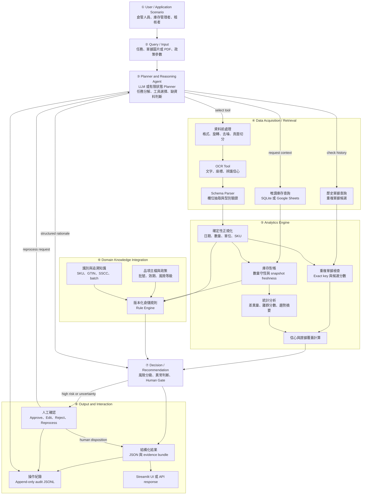

# Smart Warehouse AI Agent — System Architecture

> 版本：v0.1｜日期：2026-10-24  
> 設計原則：local-first、read-only inventory access、evidence-first reasoning、human-gated decision、append-only audit。

## 1. Architecture Diagram



## 2. 技術責任邊界

| 類型 | 執行內容 | 不得執行 |
|---|---|---|
| **LLM／Agent** | 將自然語言任務映射到允許的工作流程；依 state 選 OCR、庫存查詢或歷史查詢工具；整理已取得 facts、conflicts、unknowns；決定補資料、停止或升級 | 不直接讀寫正式 WMS；不自行創造 SKU、數量或倉儲政策；不取代 OCR、SQL、統計計算或 Rule Engine；不輸出隱藏思考過程 |
| **確定性規則** | 檔案與 schema 驗證、日期／數量／單位正規化、SQL 查詢、exact duplicate key、數量守恆、必要欄位、負庫存、rule severity、權限與 stop conditions | 不處理無法由明確條件表達的版面語意；不把模糊候選當作確認事實 |
| **統計分析** | OCR confidence aggregation、欄位差異、異常分數、歷史頻率、threshold calibration、latency 與資源統計 | 不單獨核准高風險交易；不把離群等同於錯誤或舞弊 |
| **人工** | 核准、修改、拒絕、補件、確認候選識別碼、決定高風險例外 | 不應在沒有來源與變更理由的情況下覆寫原始紀錄 |

Planner 只有在能根據任務與中間結果選擇不同工具、補查資料、停止或升級時才稱為 Agent。單純順序呼叫 OCR、parser 與 rules 的固定 pipeline 為 baseline B1，不稱為 Agent。

## 3. 八個模組契約

### ① User / Application Scenario

| 項目 | 定義 |
|---|---|
| 功能 | 定義操作者、任務目的與決策權限；支援收貨比對、出貨前檢查、盤點差異與重複單據檢查 |
| 輸入 | 使用者身分、角色、scenario、warehouse ID |
| 輸出 | `UserContext` |
| 資料格式 | JSON：`user_id`, `role`, `scenario`, `warehouse_id` |
| 依賴 | Authentication adapter；MVP 可使用本機測試角色 |
| 失敗處理 | 身分或 scenario 不合法即拒絕；不建立 Agent task |

### ② Query / Input

| 項目 | 定義 |
|---|---|
| 功能 | 接收自然語言任務、JPG／PNG／PDF、庫存來源與政策版本 |
| 輸入 | 文件、query、SQLite path 或 Google Sheet reference、policy ID |
| 輸出 | `TaskEnvelope`、file hash、trace ID |
| 資料格式 | Multipart file + JSON metadata；文件轉為 page images |
| 依賴 | File validator、PDF renderer、hash library |
| 失敗處理 | 不支援格式、超過大小、損毀或加密 PDF → `INPUT_REJECTED`；要求重新上傳 |

### ③ Planner & Reasoning Agent

| 項目 | 定義 |
|---|---|
| 功能 | 理解任務、建立有限步驟計畫、選擇 allowlisted tools、依結果補查或停止；用 evidence IDs 形成結構化 rationale |
| 輸入 | `TaskEnvelope`, current state, prior tool results, policy |
| 輸出 | `PlanStep`：`action`, `arguments`, `reason_code`, `remaining_steps`；以及 `FactBundle` |
| 資料格式 | Schema-constrained JSON；不保存 hidden chain-of-thought |
| 依賴 | 可選 LLM adapter、finite-state controller、tool registry、schema validator |
| 失敗處理 | JSON 不合法可修復一次；越權 tool、循環、timeout 或步數耗盡 → fail-safe human review |

### ④ Data Acquisition / Retrieval

| 項目 | 定義 |
|---|---|
| 功能 | 文件前處理、OCR、欄位抽取，以及唯讀查詢庫存、品項主檔與歷史單據 |
| 輸入 | Page images、query keys、data-source config |
| 輸出 | `OCRSpan[]`, `DocumentFields`, `InventoryRow[]`, `DocumentHistory[]` |
| 資料格式 | OCR：JSON `{page,bbox,text,confidence}`；資料列：typed JSON with row ID and `as_of_time` |
| 依賴 | PaddleOCR 或 Tesseract、Pydantic、SQLite；Google Sheets API 為可選 adapter |
| 失敗處理 | OCR 低信心可前處理後重跑一次；DB/Sheets 無法連線不得以空結果取代，回傳 `DATA_SOURCE_UNAVAILABLE` |

### ⑤ Analytics Engine

| 項目 | 定義 |
|---|---|
| 功能 | 正規化欄位、重複檢查、帳實／單據對帳、統計差異與 evidence coverage |
| 輸入 | Document fields、inventory rows、history、OCR confidence |
| 輸出 | `AnalyticFinding[]`, duplicate candidates、reconciliation result、confidence summary |
| 資料格式 | Typed JSON；數量使用 decimal，不使用 binary float；時間使用 ISO 8601 |
| 依賴 | pandas、Python statistics、rapid string matching（僅候選） |
| 失敗處理 | 單位不可換算、時間基準不明或樣本不足 → `UNKNOWN`，禁止捏造統計結論 |

### ⑥ Domain Knowledge Integration

| 項目 | 定義 |
|---|---|
| 功能 | 套用有來源、版本、severity 的倉儲規則；整合 SKU/GTIN/SSCC、batch、expiry 與品項政策 |
| 輸入 | Validated fields、analytics findings、master data、rule version |
| 輸出 | `RuleHit[]`：rule ID、severity、facts、evidence IDs、recommended control |
| 資料格式 | YAML/JSON rule definitions；JSON evaluation results |
| 依賴 | Deterministic Rule Engine、policy repository、GS1 mapping |
| 失敗處理 | 規則版本不存在、衝突或必要 master data 缺少 → configuration error 或 human review；LLM 不得補造規則 |

### ⑦ Decision / Recommendation

| 項目 | 定義 |
|---|---|
| 功能 | 綜合 severity、confidence、evidence coverage、source conflict、freshness，產生有限 disposition |
| 輸入 | FactBundle、AnalyticFinding、RuleHit、policy thresholds |
| 輸出 | `PASS_RECOMMENDED`, `FLAG_ANOMALY`, `REQUEST_CORRECTION`, `HUMAN_REVIEW_REQUIRED`, `BLOCK_RECOMMENDED` |
| 資料格式 | `DecisionRecord` JSON，包含 reason codes、evidence IDs、risk level |
| 依賴 | Deterministic decision table；LLM 只生成受證據約束的摘要 |
| 失敗處理 | 高風險、低信心、矛盾、未知類型或 coverage 不足一律升級；原型無庫存寫入能力 |

### ⑧ Output & Interaction

| 項目 | 定義 |
|---|---|
| 功能 | 顯示原圖證據、抽取欄位、異常、建議與人工控制；保存可重播操作紀錄 |
| 輸入 | DecisionRecord、evidence bundle、trace |
| 輸出 | UI/API response、review action、append-only audit entry |
| 資料格式 | JSON response、JSONL audit、可選 CSV export |
| 依賴 | Streamlit 或 FastAPI、local evidence store |
| 失敗處理 | UI 或 log 寫入失敗時不得顯示「完成」；人工修改以新版本追加，不覆寫原紀錄 |

## 4. 資料儲存與介面

| Store / Interface | 用途 | 權限 | 預設 |
|---|---|---|---|
| SQLite | 庫存快照、品項主檔、歷史單據、測試 fixture | Agent read-only；測試資料由獨立 loader 寫入 | 是 |
| Google Sheets | 小組協作或教師可視資料來源 | Service account 最小權限；Agent read-only | 選配 |
| Local files | 單據與處理中 page images | 工作目錄隔離、檔名正規化 | 是 |
| JSONL audit | 工具呼叫、版本、決策與人工動作 | append-only application interface | 是 |
| YAML/JSON rules | Domain rules 與 policy thresholds | 版本控制；runtime read-only | 是 |

## 5. 主要資料型別

```text
TaskEnvelope      = task_id, user_context, intent, document_ref, data_source, policy_version
OCRSpan           = span_id, page, bbox, text, confidence, engine_version
DocumentField     = field_name, raw_value, normalized_value, confidence, evidence_ids
InventoryRow      = row_id, warehouse_id, sku, on_hand, reserved, batch, expiry, as_of_time
AnalyticFinding   = finding_id, finding_type, observed, expected, score, evidence_ids
RuleHit           = rule_id, rule_version, severity, facts, evidence_ids
DecisionRecord    = disposition, risk_level, reason_codes, evidence_ids, human_required
AuditEvent        = trace_id, timestamp, actor, action, input_hash, versions, outcome
```

## 6. 依賴順序

`① → ② → ③` 建立任務；③只能調用④核准工具。④提供可追溯 facts 給⑤，⑤與⑥互相以 typed facts 連接，不能以自由文字繞過 schema。⑦只接受通過 validation 的⑤／⑥輸出；⑧保存⑦與人工結果。人工要求重新處理時回到③，但沿用 trace ID 並增加 attempt number。

