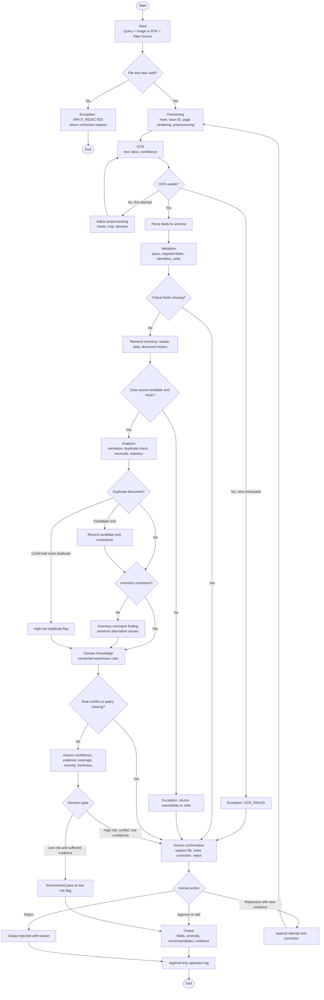

# Smart Warehouse AI Agent — Processing Flowchart

> 流程涵蓋 Input → Processing → OCR → Validation → Analytics → Domain Knowledge → Decision → Output，並包含辨識失敗、缺欄、重複、庫存不一致、人工確認與重新處理。

## 決策與迴圈說明

| 節點 | 條件 | 動作 | 是否可重試 |
|---|---|---|---|
| File and task valid | 格式、大小、權限、scenario | 不合法即拒絕 | 使用者可重新上傳 |
| OCR usable | 關鍵區域可讀且 confidence 達政策門檻 | 第一次失敗可改變影像前處理 | 自動最多一次 |
| Critical fields missing | SKU、數量、document ID 等依 scenario 判定 | 轉人工補值或換檔 | 人工可要求 reprocess |
| Data source available and fresh | SQLite/Sheets 可讀、`as_of_time` 可接受 | 不可用或過期即停止自動判斷 | 資料恢復後可重跑 |
| Duplicate document | exact composite key 或僅 fuzzy candidate | Exact 標高風險；candidate 保持不確定 | 人工確認後可繼續 |
| Inventory consistent | 單位、時間與事件考量後仍有差異 | 建立 mismatch finding，不直接指定原因 | 補充事件後可重跑 |
| Rule conflict | 規則互斥、版本缺失、政策未定 | 轉人工／設定錯誤 | 修正規則版本後重跑 |
| Decision gate | severity、confidence、coverage、freshness | 低風險建議或 human gate | 人工可 approve/edit/reject/reprocess |

## Exception 原則

- 工具 error 與「查無資料」是不同狀態；連線失敗不得偽裝成空集合。
- 自動 retry 只允許一次且必須改變前處理參數，避免無限迴圈。
- 人工 reprocess 沿用 `trace_id`，增加 `attempt_no`，保留之前結果。
- 所有 End path 均留下 audit event；log 失敗時整體狀態不得標示完成。

