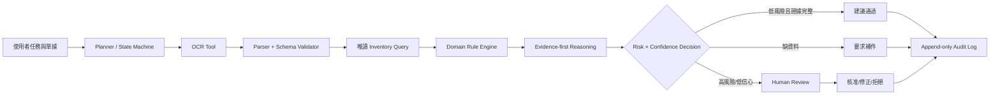

# Smart Warehouse AI Agent 專題計畫

> 文件狀態：Proposal v0.1｜更新日期：2026-10-24  
> 專題全名：**Smart Warehouse AI Agent — 智慧倉儲單據辨識與庫存異常決策代理人**  
> 本階段僅規劃與可行性設計；所有尚未執行的效果均標為 **Expected Outcomes**。

## 1. 專題定位

本專題研究一個可在一般學生電腦執行的 Domain AI Agent。系統接收入庫單、出庫單或盤點單影像與庫存快照，先擷取可追溯的欄位證據，再依倉儲規則比對數量、料號、批號、效期與單據關聯；遇到缺欄、衝突或低信心時，主動要求補資料或轉交人工確認，而不是直接修改正式庫存。

系統邊界：本原型提供「辨識、分析、建議、稽核紀錄」，不自動執行不可逆的 ERP/WMS 異動，也不宣稱取代倉管人員。

### 1.1 真實問題 → 研究問題

| 真實問題 | 研究問題（RQ） | 可測量目標／假設 |
|---|---|---|
| 單據版型與影像品質不一，人工輸入容易漏欄或打錯 | RQ1：加入結構化抽取與欄位驗證後，是否優於純 OCR？ | 比較三方案的欄位 Precision、Recall、F1、Exact Match、CER；**Expected Outcome：** OCR + Rules 與 OCR + Agent 的欄位 F1 高於純 OCR |
| 單據數量與庫存帳不一致時，單純 OCR 無法說明原因 | RQ2：Agent 使用倉儲規則與工具後，能否更準確找出異常類型？ | 異常偵測 Precision／Recall／F1、誤報率、漏報率；**Expected Outcome：** Agent 對跨來源矛盾的 Recall 較佳 |
| 高風險決策需要證據與人工覆核 | RQ3：證據鏈、信心閾值與 Human-in-the-loop 能否提升決策安全性？ | 證據完整率、可追溯率、適當升級率、錯誤自動通過率；**Expected Outcome：** 高風險錯誤自動通過率下降 |
| Agent 可能增加時間與運算成本 | RQ4：效能提升是否值得額外延遲與資源？ | 每張處理時間、峰值 RAM、工具呼叫數、每件成本（若使用付費 API）；報告 Accuracy–Latency trade-off，不預設勝者 |

### 1.2 成功門檻（Proposal 預註冊草案）

以下是實驗前門檻，不是既有結果：

- OCR + Agent 的異常偵測 macro-F1 相較最佳非 Agent baseline 提升至少 5 個百分點。
- 高風險錯誤自動通過率不高於 2%；不確定案件必須轉人工。
- 90% 以上的最終建議可回指到原始影像區域、庫存列或規則 ID。
- 在指定學生電腦基準環境（待登錄 CPU、RAM、OS）中，單張處理時間中位數不超過 30 秒。
- 若資料量不足，以上只作為 feasibility target，結論需附信賴區間與限制。

## 2. 系統目標、使用情境、使用者、輸入與輸出

### 2.1 使用者與情境

- 倉管人員：上傳單據、查看抽取欄位、接受或修正建議。
- 庫存管理者：審核數量差異、重複入庫、未知料號、效期或批號異常。
- 稽核／指導教師：由 decision log 重建「使用了哪些資料、規則及人工核准」。
- 開發者／研究者：執行相同測試集、baseline 與 ablation study。

主要情境：收貨比對、出貨扣帳前檢查、盤點差異分析、重複單據檢查。第一版不處理即時機器人路徑規劃或自動採購。

### 2.2 輸入與輸出

輸入：JPG／PNG／PDF 單據、CSV／SQLite 庫存快照、品項主檔、規則設定、使用者任務。測試資料必須去識別化，不納入真實姓名、電話、地址或商業機密。

輸出：

1. 結構化單據 JSON（單號、日期、動作、料號、品名、數量、單位、批號、效期等）。
2. 每欄信心分數與 evidence pointer（頁碼、bounding box、OCR 片段或資料列 ID）。
3. 異常清單（類型、嚴重度、觸發規則、證據、可能原因）。
4. 建議動作（通過、請補資料、人工覆核、暫停入出庫）；不直接寫回正式庫存。
5. 可重播的稽核紀錄（輸入雜湊、版本、工具呼叫、規則、決策、人工結果）。

## 3. Agent 定義

| 元件 | 明確定義 | 用途 | 輸入 | 輸出 | 驗證方法 |
|---|---|---|---|---|---|
| Planner | 有限狀態工作流程，而非自由無限迴圈 | 將任務拆成辨識、正規化、查詢、驗證、決策與升級 | 任務、文件類型、目前 state | 下一個 tool、停止條件、缺資料清單 | 狀態轉移測試；最多步數；非法工具呼叫率 |
| OCR Tool | PaddleOCR 或 Tesseract（最終選型以中文實測決定） | 擷取文字、位置與 OCR 信心 | 文件影像 | text spans、bbox、confidence | CER／WER、欄位召回率、低品質分層測試 |
| Parser Tool | Python schema + deterministic parser；可選本地小型 LLM 作補助 | 將 OCR 結果映射至欄位 | OCR spans、版面資訊 | schema-valid JSON、欄位信心 | Exact Match、欄位 micro/macro-F1、JSON valid rate |
| Inventory Query Tool | pandas + SQLite 唯讀查詢 | 查詢 on-hand、保留量、批號、效期與歷史單號 | 正規化料號、倉位等 | 帶 row ID 的資料列 | fixture tests、SQL 結果與人工答案比對 |
| Rule Engine | YAML/JSON 規則 + Python evaluator | 執行數量守恆、重複單號、未知 SKU、負庫存、批號／效期等規則 | 單據 JSON、庫存列、主檔 | rule hits、severity、evidence | 規則單元測試與 mutation/edge cases |
| Evidence Store | append-only JSONL（原型） | 保留來源、版本與決策鏈 | 各步輸入輸出與雜湊 | trace ID、evidence bundle | 完整率、hash 重算、trace replay |
| Reasoning | 受限制的 evidence-first 推論：先列事實，再套規則，再形成假設 | 處理多欄位與跨資料來源衝突 | 已驗證 facts、rule hits、信心 | anomaly hypothesis、理由、未知項 | 黃金 reasoning checklist；禁止無證據欄位；一致性測試 |
| Decision | 風險×信心矩陣與人工閘門 | 決定通過、補件、覆核或阻擋 | 異常、severity、confidence、政策 | 建議、原因碼、需確認欄位 | confusion matrix、錯誤自動通過率、升級率 |
| Human Review UI | Streamlit 表單 | 顯示影像證據並收集修正／核准 | evidence bundle、建議 | approve/edit/reject、備註、時間戳 | 任務完成率、修正時間、使用者一致性 |

### 3.1 Domain Knowledge 初始規則

- DK-01：單號在同一供應商與單據類型下不得重複；否則標示 duplicate risk。
- DK-02：入／出庫數量必須為正數，且單位需能由 unit mapping 正規化。
- DK-03：出庫後預估可用量不得為負；若為負則 high severity 並轉人工。
- DK-04：SKU 必須存在品項主檔；模糊比對只能提出候選，不可自行替換。
- DK-05：受批號管理品項不得缺 batch/lot；受效期管理者不得缺 expiry date。
- DK-06：效期早於單據日期，或距到期日少於可設定門檻，需警示。
- DK-07：單據合計數量與明細合計不一致時不得自動通過。
- DK-08：關鍵欄位低於信心門檻、來源互相矛盾、或證據缺失時升級人工。

規則門檻均放在設定檔並記錄版本；真實企業政策尚未取得者標示「待查證」，不得包裝成通用產業標準。

## 4. 三種方案比較與 Baseline

| 面向 | B0 人工輸入與人工核對 | B1 OCR + Fixed Rules | B2 OCR + Domain AI Agent（本方案） |
|---|---|---|---|
| 流程 | 人員讀取文件、輸入欄位並依相同政策核對 | image → OCR → parser → fixed rules | planner 調用 OCR、parser、庫存、rules、evidence、review |
| Domain Knowledge | 由受訓人員依相同政策使用 | 固定規則 | 版本化規則 + 任務規劃 + 缺資料處理 |
| 跨來源判斷 | 人工查詢與判斷 | 預先寫死的比對 | 可依 state 選工具、收集證據與停止／升級 |
| 輸出 | 人工欄位、異常判定與處置 | 欄位與 rule hits | 有證據的建議、信心、風險及人工閘門 |
| 可解釋／稽核 | 依人工表單與計時紀錄 | 中 | 高，但必須驗證 trace 是否完整 |
| 成本與風險 | 人工時間高；可能有輸入與疲勞錯誤 | 低至中；彈性有限 | 較高；有 hallucination、延遲與 prompt sensitivity |
| 公平比較 | 三組共用 test manifest、gold labels、庫存快照、政策與計時規則 | B1/B2 另共用 OCR、parser、rules 與硬體 | 相對 B1 只增加 Agent orchestration、evidence gate 與 escalation |

## 5. Proposed Scheme 與系統架構



### 5.1 執行流程

1. 驗證檔案類型、大小與任務範圍，建立 trace ID。
2. Planner 選擇 OCR；Parser 產生 schema-valid JSON 與欄位證據。
3. 關鍵欄位不足時先嘗試允許的重跑／預處理一次，仍不足即補件或人工覆核。
4. 以正規化鍵唯讀查詢庫存與品項主檔。
5. Rule Engine 產生明確 rule hits；Reasoning 僅能引用既有 evidence IDs。
6. Decision Policy 依風險、信心與證據完整度決定 disposition。
7. 人工結果與全部版本資訊寫入 audit log；原型不自動改庫存。

### 5.2 具有行號的 Pseudocode

```text
01  function ANALYZE(task, document, inventory_snapshot, policy):
02      trace ← START_TRACE(hash(document), versions(), task)
03      if not VALID_INPUT(document, task):
04          return LOG_AND_STOP(trace, "REQUEST_CORRECTION")
05      state ← PLAN(task, allowed_tools=policy.allowed_tools)
06      ocr ← OCR_TOOL(document)
07      fields ← PARSE_TO_SCHEMA(ocr.text, ocr.boxes)
08      evidence ← LINK_FIELDS_TO_EVIDENCE(fields, ocr)
09      if MISSING_CRITICAL(fields) or LOW_CONFIDENCE(fields):
10          fields, evidence ← RETRY_ONCE_WITH_PREPROCESSING(document)
11      if MISSING_CRITICAL(fields):
12          return HUMAN_GATE(trace, "MISSING_DATA", evidence)
13      records ← INVENTORY_QUERY_READ_ONLY(inventory_snapshot, fields.keys)
14      hits ← RULE_ENGINE(fields, records, policy.rule_version)
15      hypothesis ← REASON_FROM_EVIDENCE_ONLY(fields, records, hits, evidence)
16      coverage ← EVIDENCE_COVERAGE(hypothesis)
17      risk ← SCORE_RISK(hits.severity, fields.confidence, coverage)
18      if risk.high or coverage < policy.minimum_coverage:
19          decision ← HUMAN_GATE(trace, "REVIEW_REQUIRED", evidence, hits)
20      else:
21          decision ← RECOMMEND_ONLY(hypothesis, hits)
22      ASSERT_NO_INVENTORY_WRITE()
23      return APPEND_AUDIT_LOG(trace, decision, evidence, hits, versions())
```

## 6. Dataset 計畫

### 6.1 三層資料

1. 公開 pretest：SROIE（收據 OCR/KIE）、FUNSD（表單理解）、DocVQA（文件問答）；用來驗證 pipeline，不宣稱代表臺灣倉儲。
2. 專題主資料：自製去識別化中英倉儲單據，建議 300–500 張、至少 3 種類型與 5 種版型；實際數量依取得情況登錄，不先宣稱完成。
3. 配對庫存情境：CSV／SQLite 快照與人為注入異常，正常／異常皆保留；異常模板及 random seed 納入版本控制。

建議標註欄位：document_type、document_id、date、supplier/customer、warehouse、SKU、description、quantity、unit、batch、expiry、line_total，以及欄位 bbox、人工 ground truth、異常類型、severity 與 expected decision。

### 6.2 資料切分與防洩漏

- 以供應商／版型 group split，建議 60/20/20 train/validation/test；最終比例在資料卡凍結。
- 同一原始單據的增強版本不得跨 split；測試集在規則與 prompt 凍結前封存。
- 至少兩名標註者重疊標註 10–20%，計算 Cohen's kappa（類別）及欄位一致率；爭議由第三人裁決。
- 公開資料授權、專題自製資料同意與去識別程序寫入 `data/DATA_CARD.md`；無權公開的影像不得進 Git。
- 稀有異常可用合成資料補強，但需與真實／自製資料分層報告，不能混合宣稱真實效能。

## 7. Evaluation Metrics 與實驗

### 7.1 指標

- OCR：CER、WER；依清晰／模糊、旋轉、低光分層。
- 欄位抽取：per-field Precision／Recall／F1、micro/macro-F1、Exact Match、JSON valid rate。
- 異常：per-class 與 macro-F1、PR-AUC、誤報率、漏報率；類別不平衡時不只報 accuracy。
- 決策安全：錯誤自動通過率、適當升級率、人工修正率、evidence coverage、trace replay success。
- 系統：中位數與 P95 latency、峰值 RAM、工具呼叫數、失敗恢復率；若有 API，再報每件成本。
- 人因（小型可行性測試）：審核時間、task completion rate、SUS（若受試者與倫理程序允許）。

所有主要指標附 bootstrap 95% confidence interval；三方案對同一測試樣本做 paired comparison。顯著性方法在看過 test 結果前凍結。

### 7.2 實驗矩陣

| Exp | 問題 | 比較／消融 | 控制條件 |
|---|---|---|---|
| E1 | OCR 與欄位抽取能力 | B0 vs B1 vs B2 | 同一影像、OCR engine、split |
| E2 | 異常決策能力 | 三 baseline；逐異常類別 | 同一 ground truth 與規則版本 |
| E3 | Agent 元件價值 | 移除 inventory tool／rules／evidence gate／retry | 其餘參數固定 |
| E4 | 影像魯棒性 | 清晰、模糊、旋轉、遮擋、低光 | 固定擾動等級與 seed |
| E5 | 未見版型泛化 | template-held-out test | 禁止 test template 調參 |
| E6 | 安全與人工覆核 | confidence threshold sweep | 報 coverage–risk curve |
| E7 | 可行性 | latency、RAM、離線／API 選項 | 登錄硬體、套件與版本 |

報告結構一律使用「Method → Observed Results → Limitations」。現階段只可寫：**Expected Outcomes：B2 預期在跨來源異常與可追溯決策優於 B0/B1，但延遲與複雜度較高。**

## 8. Proposal 章節規劃

| 章節 | 建議內容 | 主要產物 |
|---|---|---|
| Abstract | 問題、研究缺口、三方案、方法、資料、指標、Expected Outcomes | 200–300 字摘要；不得寫未執行結果 |
| Introduction（20%） | 倉儲單據痛點、為何 OCR 不等於決策、RQ1–RQ4、貢獻與範圍 | 問題—缺口—目標—貢獻鏈 |
| Related Work（20%） | OCR/KIE、document understanding、agentic document AI、inventory anomaly、human oversight | 來源比較表；指出各方法不能處理之處 |
| Deep Research（20%） | 2025–2026 文獻搜尋法、資料集與授權、GS1/domain rules、可信 AI 與 evidence provenance | 可重現 search log、evidence matrix、待查證表 |
| Proposed AI Agent（20%） | Planner、Tools、Reasoning、Domain Knowledge、Decision、人工閘門與稽核 | architecture、模組 I/O/驗證、threat model |
| Flowchart/Pseudocode/Feasibility（15%） | 流程圖、行號 pseudocode、技術選型、硬體預算、風險與時程 | Mermaid、演算法、最小可行 demo 計畫 |
| GitHub/DESIGN.md（5%） | 可重現結構、安裝、資料卡、版本與限制 | README、DESIGN、requirements、測試說明 |
| References | 僅列已讀且可追溯來源；DOI 由出版社／論文首頁核對 | reference ledger + access date |

## 9. 2025–2026 Deep Research 計畫

### 9.1 搜尋與驗證流程

- 資料庫：ACL Anthology、IEEE Xplore、ACM Digital Library、arXiv（只作 preprint）、NIST、GS1、DocVQA 官方站。
- 查詢詞：`agentic document understanding`, `invoice OCR agent`, `key information extraction`, `warehouse inventory anomaly`, `human-in-the-loop document AI`, `evidence provenance`。
- 納入：2025-01-01 至 2026-12-31 的同儕審查論文優先；官方標準與經典 benchmark 可早於 2025。
- 排除：無作者／無版本、二手行銷文章、無法取得摘要或全文、只提供不可重現宣稱者。
- 雙重查核：標題、作者、年份、venue、頁碼與 DOI 必須由出版社／官方頁面核對；arXiv 與正式版不得重複計數。
- 每筆記錄：查詢日期、來源 URL、publication status、任務、資料、metrics、限制、與本專題關聯。無法核對即標「待查證」。

### 9.2 已核對的起始來源（非完整 References）

1. Sun, L. et al. (2025). *DocAgent: An Agentic Framework for Multi-Modal Long-Context Document Understanding*. EMNLP 2025, ACL Anthology. DOI: [10.18653/v1/2025.emnlp-main.893](https://doi.org/10.18653/v1/2025.emnlp-main.893)。用途：agentic document understanding 與 reviewer/evidence 設計。
2. Hu, Y. et al. (2025). *AID-Agent: An LLM-Agent for Advanced Extraction and Integration of Documents*. REALM 2025, ACL Anthology：[官方頁面](https://aclanthology.org/2025.realm-1.6/)。用途：OCR 與 LLM agent 整合；作者完整資訊於正式撰寫時由論文首頁再次核對。
3. NIST (2024). *Artificial Intelligence Risk Management Framework: Generative Artificial Intelligence Profile*, NIST AI 600-1：[官方 PDF](https://nvlpubs.nist.gov/nistpubs/ai/NIST.AI.600-1.pdf)。用途：provenance、測試與人機風險；不是倉儲效能證據。
4. Tabassi, E. (2023). *AI RMF 1.0*, NIST AI 100-1. DOI: [10.6028/NIST.AI.100-1](https://doi.org/10.6028/NIST.AI.100-1)。用途：人工監督、透明與風險治理。
5. DocVQA (2026). *ICDAR 2026 Competition on Multimodal Reasoning over Documents in Multiple Domains*：[官方站](https://site.docvqa.org/)。狀態：2026 competition 資訊；結果與正式論文若未公布則標「待查證」。
6. Huang, Z. et al. (2019). *ICDAR2019 Competition on Scanned Receipt OCR and Information Extraction*. ICDAR. DOI: [10.1109/ICDAR.2019.00244](https://doi.org/10.1109/ICDAR.2019.00244)。用途：SROIE benchmark。
7. Jaume, G., Ekenel, H. K., & Thiran, J.-P. (2019). *FUNSD: A Dataset for Form Understanding in Noisy Scanned Documents*：[官方資料頁](https://guillaumejaume.github.io/FUNSD/)。用途：form understanding；授權限制需在資料卡列出。
8. Mathew, M., Karatzas, D., & Jawahar, C. V. (2021). *DocVQA: A Dataset for VQA on Document Images*：[官方資料頁](https://site.docvqa.org/datasets/docvqa)。用途：文件理解公開 benchmark。
9. GS1 (2023). *GS1 Logistic Label Guideline, Release 1.3.0*：[官方規範](https://ref.gs1.org/guidelines/logistic-label/1.3.0/)。用途：物流標籤與識別脈絡；專題規則是否適用仍需逐條標明範圍。

> 文獻中的效能數字在尚未閱讀方法、資料切分與表格原文前不得引用。本清單的 URL 與 metadata 已作起始核對，完整 related-work evidence matrix 尚待建立。

## 10. Repository 與文件規劃

```text
smart-warehouse-ai-agent/
├─ README.md
├─ DESIGN.md
├─ project_plan.md
├─ requirements.md
├─ proposal_checklist.md
├─ pyproject.toml
├─ configs/                 # rule/policy/model version
├─ data/
│  ├─ README.md
│  ├─ DATA_CARD.md
│  ├─ samples/              # 僅可公開的極小去識別樣本
│  └─ schemas/
├─ docs/
│  ├─ proposal.md
│  ├─ architecture.md
│  ├─ references.md
│  └─ research_log.md
├─ src/smart_warehouse_agent/
│  ├─ planner/
│  ├─ tools/
│  ├─ domain/
│  ├─ decision/
│  └─ audit/
├─ tests/
│  ├─ unit/
│  ├─ integration/
│  └─ fixtures/
├─ experiments/             # frozen configs，不提交敏感輸出
└─ results/                 # tables/figures + environment metadata
```

README.md 應包含：研究問題、系統界線、架構圖、quick start、demo、資料取得、評估指令、Expected/Observed 區隔、限制、隱私與引用。DESIGN.md 應包含：ADR、模組契約、schema、狀態機、規則格式、信心／風險政策、evidence model、failure modes、security/privacy、測試策略與未解決問題。

## 11. 執行時程與 Gate

| 階段 | 產出 | Exit criteria |
|---|---|---|
| P0 Proposal | 本計畫、requirements、checklist | RQ、baseline、metrics、來源規則經指導教師確認 |
| P1 Research freeze | evidence matrix、reference ledger、data card 草案 | 每項核心主張可追溯；待查證項清楚隔離 |
| P2 Data pilot | 30–50 張 pilot + schema + annotation guide | 可標註、無敏感資料、雙人一致性可計算 |
| P3 Baselines | B0、B1 可重現 | 相同 split、環境與 metrics；結果標 Observed |
| P4 Agent MVP | B2、audit log、human gate | 端到端 demo；不寫正式庫存；失敗安全 |
| P5 Evaluation | E1–E7 或核准的縮減版 | frozen test、CI、error analysis、資源報告 |
| P6 Final delivery | Proposal/報告、README、DESIGN、demo | checklist 通過；引用與結果逐項稽核 |

## 12. 主要風險與緩解

- 中文倉儲公開資料不足：建立小型去識別資料；公開 benchmark 只作技術 pretest。
- Agent hallucination：schema validation、evidence-only reasoning、tool allowlist、人工閘門。
- 不公平 baseline：共用 OCR、split、schema、rules，公開 frozen configs。
- 規則被誤認為產業標準：每條標 source／owner／version；未有依據者標「專題假設」。
- 個資與商業機密：資料最小化、去識別、禁止原始敏感影像上 Git。
- 計算資源：優先 CPU 可跑的 OCR、pandas、SQLite、規則引擎；LLM 設為可插拔，不以昂貴 fine-tuning 為必要條件。
